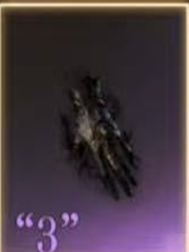

# 封印物图鉴（18 件）

> 来源：用户提供的游戏内截图。共 18 件：攻击 6 件、防御 6 件、特化 6 件。数值与截图中的危险等级、角色面板及当前版本相关。图标由游戏截图原样裁切、居中和放大，未进行生成式重绘。

## 攻击封印物（6 件）

### 1. 丧钟

**非凡能力**

弱点攻击：佩戴者攻击主目标时，可对其施加弱点揭露效果，每秒最多揭露 1 层，最多可揭露 30 层。每消耗 15 层，可扣下丧钟的扳机，攻击目标灵体，造成 24415 点伤害、3 秒受到治疗增幅降低 70% 和移动速度降低 60% 效果，另有 60% 的基础概率使目标眩晕 1 秒。若目标处于霸体状态，则对其重新施加 3 层弱点揭露。

**负面效果**

- 灌注灵性：佩戴者扣下扳机时，消耗自身 20 点体力值作为代价；若体力不足 20 点，则清空体力，并在接下来的 2 秒内无法恢复体力。
- 弱点反噬：佩戴者使用丧钟后的 2 秒内无法继续揭露弱点，期间减伤降低 10%。
- 排异：战斗中每隔 30 秒，随机一条非凡物质词条属性失效。

### 2. 幸运草

**非凡能力**

眷顾：佩戴者施放普攻和非解控类技能时，有概率触发持续 10 秒的幸运；每层提高移动速度 2.5%、暴击 303、技能增强 59。未触发幸运则积攒概率至下一次技能施放，直至触发。触发概率随持有幸运的层数逐渐降低，初始概率为 25%，5 层时触发概率降至 0。

**负面效果**

- 枯竭：幸运结束时，佩戴者陷入持续 4 秒的困顿：移动速度降低 20%、体力恢复速度降低 20%，且期间无法触发幸运。
- 排异：战斗中每隔 30 秒，随机一条非凡物质词条属性失效。

### 3. 黄昏面具

**非凡能力**

窥伺冥界：携带者获得技能“黄昏面具”：戴上面具，沉入现实和冥界的交界处，在无休止的尖啸刺激下强化所有战斗技能，提升其 36% 攻击速度，每秒返还其冷却时间 0.24 秒。携带者可承受 20 秒；期间若造成击杀或助攻，则能延长承受时间 5 秒，延长效果最多可触发 2 次。技能冷却时间：60 秒。

**负面效果**

- 尖啸虚弱：携带者脱离尖啸刺激时，若依然身处战斗之中，则会陷入虚弱，降低 5% 攻击、15% 移动速度，直至离开战斗或再次戴上面具。
- 排异：战斗中每隔 30 秒，随机一条非凡物质词条属性失效。

### 4. 蠕动的饥饿

**非凡能力**

放牧灵魂：穿戴者持续攻击主目标一段时间后，可将其灵魂剥离到自己脚下，10 秒内触碰灵魂可将其吞噬，并根据灵魂主人的类型产生不同效果。

- 吞噬非凡者的灵魂：对其造成伤害，并通过囚禁其灵魂获得对应序列的一个技能，使用该技能会释放其灵魂。战士序列：黎明铠甲；歌颂者序列：太阳誓约；学徒序列：星云咏叹；观众序列：心理暗示；占卜家序列：诡秘之境；窥秘人序列：星光囚笼。提升危险等级时，对应技能强度随之提升。
- 吞噬怪物的灵魂：立刻粉碎灵魂，对目标和周围最多 5 名怪物造成伤害，并给目标施加持续 5 秒的灵魂压制效果，使其受到来自施加者的伤害提高。
- 剥离灵魂效果每 20 秒最多触发一次；囚禁的灵魂释放前，无法再次从其主人身上剥离灵魂；最多可同时囚禁 3 个灵魂。

**负面效果**

- 灵魂重负：每囚禁一个非凡者灵魂，期间自身生命值上限降低 8%。
- 贪食血肉：粉碎怪物灵魂后，受到的伤害提高 5%，持续 10 秒。
- 排异：战斗中每隔 30 秒，随机一条非凡物质词条属性失效。

### 5. 飓风之斧

**非凡能力**

- 飓风：持有者战斗中移动速度提高 10%，普攻攻速提高 10%。
- 闪电：持有者普攻命中敌对目标时，有 15% 概率对目标释放闪电打击，造成 3167 点伤害；闪电有 40% 的基础概率造成 3 秒滞涩效果。

**负面效果**

- 引雷：持有者对目标触发闪电时，有 50% 概率对自己也施加闪电造成伤害；闪电有 50% 概率触发 3 秒滞涩效果。
- 排异：战斗中每隔 30 秒，随机一条非凡物质词条属性失效。

### 6. 公证书

**非凡能力**

公证：携带者在战斗中施放普通技能和终结技能时，自动触发对该技能的公证，分别有 80%／10% 的概率公证成功，获得 1／2 层公证；有 10% 概率公证失败，失去 1 层公证。每层公证使携带者提高 23 攻击和 4.6 技能增强。公证最多可累积 40 层。技能触发的公证超出层数上限时，超出的层数自动消耗，每层使该技能本次施放的增伤提高 10%、治疗增幅提高 10%。离开场景时清除所有公证层数。

**负面效果**

- 伪证罪：携带者的技能公证失败时，该技能本次施放造成的增伤降低 60%、治疗增幅降低 60%。
- 排异：战斗中每隔 30 秒，随机一条非凡物质词条属性失效。

## 防御封印物（6 件）

### 7. 正义钱包

**非凡能力**

- 苏勒防身：携带者减伤提高 12%。
- 苦难财富：携带者受到伤害时，根据累积受到伤害值提高防御，持续 30 秒，防御最多提高 552 点。

**负面效果**

- 钱多压身：携带者持有苦难财富超过 20 秒后，若依然处于战斗中，则会每隔 10 秒陷入持续 5 秒的不堪重负状态：降低 10% 移动速度和 25% 体力恢复速度。
- 排异：战斗中每隔 30 秒，随机一条非凡物质词条属性失效。

### 8. 生物毒素瓶

**非凡能力**

- 毒素弥漫：携带者受到 8 米内的敌人攻击时，有 100% 的基础概率使其随机染上 3 种毒素之一，持续 8 秒；每种毒素最多叠加 5 层。染毒效果每 0.5 秒最多触发 1 次，对单个目标每 2 秒最多触发 1 次。
- 毒素侵染：携带此封印物 5 分钟后进入毒素入骨状态。携带者在该状态下死亡时会残留持续 10 秒的毒池；毒池出现时，有 100% 基础概率禁锢范围内的敌人 3 秒，并每秒尝试给范围内敌人各施加 1 层 3 种毒素。身处毒池内时，移动速度降低 50%；毒池最多影响 10 人。
- 麻痹毒素：降低 1% 攻击速度，最多 5 层；5 层后继续添加时，有 40% 固定概率进入 1 秒滞涩状态。
- 虚弱毒素：降低 1% 攻击力，最多 5 层；5 层后继续添加时，有 40% 固定概率进入 1 秒沉默状态。
- 疲劳毒素：降低 1% 移动速度，最多 5 层；5 层后继续添加时，有 40% 固定概率进入 1 秒减速 50% 状态。

**负面效果**

- 挥发性：战斗中每隔 1 秒，携带者会染上 3 种毒素中的随机一种，持续 8 秒。当携带者对攻击者染毒时，有 65% 概率优先将自身承受的毒素传递出去。
- 排异：战斗中每隔 30 秒，随机一条非凡物质词条属性失效。

### 9. 荣耀之证

**非凡能力**

奥尔米尔的冠冕：将佩戴者的解控技能置换成更强大的“荣耀之证”。解除自身控制，进入 4 秒光芒牢笼状态，期间获得霸体和 50% 减伤；将每次受到伤害里不超过生命值上限 10% 的部分，按 0.6 倍反弹给攻击者。对 8 米外目标，反弹伤害额外衰减，最多衰减至 8 米内的 20%。光芒牢笼结束时，对周身 8 米内最多 6 名敌对目标造成 15837 点伤害，并施加持续 10 秒的眩目效果，使其攻击降低 736。技能冷却时间：30 秒。

**负面效果**

- 光芒耗散：光芒牢笼反弹伤害时，延长荣耀之证冷却时间 0.5 秒，最多触发 10 次。
- 排异：战斗中每隔 30 秒，随机一条非凡物质词条属性失效。

### 10. 安静发丝

**非凡能力**

镇定情绪：战斗中激活，安抚携带者周围的敌方目标。若敌方目标身处携带者 8 米范围内超过 3 秒，则会进入持续 4 秒的迷失状态。敌方若攻击携带者，则会加速这一进程，触发加速的间隔为 1 秒；敌方受到伤害会延缓这一进程，触发延缓的间隔为 2 秒。每 10 秒最多使周围目标进入一次迷失状态。

迷失：无法移动或跳跃，攻击速度降低 50%；受到伤害会缩短迷失的剩余时间。

**负面效果**

- 欲望剥离：战斗中每隔 7 秒，携带者也会进入迷失状态，持续 1 秒。携带者受到伤害或治疗均会延缓这一进程。
- 排异：战斗中每隔 30 秒，随机一条非凡物质词条属性失效。

### 11. 月亮纸人

**非凡能力**

纸人庇护：主人受到致命伤害时，触发 8 秒的纸人庇护效果，期间纸人代主人承受过量伤害，提高主人的控制闪避 184 和控制抵挡 368，使主人免疫移动速度降低效果。纸人承受的过量伤害总额不超过主人生命值上限的 56%；达到上限时，庇护效果提前结束。庇护效果每 120 秒最多触发一次。

**负面效果**

- 脆弱：庇护效果结束时，纸人所承受溢出伤害的 15% 会重新作用到主人身上，并使主人在接下来的 15 秒内减伤降低 15%。
- 排异：战斗中每隔 30 秒，随机一条非凡物质词条属性失效。

### 12. 绿华

**非凡能力**

治愈轻伤：佩戴者生命值不满且高于 50% 时，绿华每秒为佩戴者恢复已损失生命值的 4.5%（恢复量不低于生命值上限的 0.5%）。如果佩戴者生命值已满，绿华会转而治疗周围生命值最低的队友；同一单位在 1 秒内无法多次受到来自他人绿华的治疗。绿华的恢复效果受减疗和重伤影响。

**负面效果**

- 招惹蚊虫：佩戴者持有护盾时，每秒减少 2.5% 生命值上限等额的护盾值。
- 排异：战斗中每隔 30 秒，随机一条非凡物质词条属性失效。

## 特化封印物（6 件）

### 13. 生命手杖

**非凡能力**

- 生命能量：携带者每隔 20 秒获得 1 点生命能量，持有上限为 3 点。携带者对自身或友方单位造成的累计有效治疗超过自身生命值上限的 50% 时，消耗 1 点生命能量，对目标附加 3 层蓬勃生长效果，持续 10 秒，并获得 1 枚生命之种，持有上限为 3 枚。
- 蓬勃生长：生命值不满时，每秒消耗 1 层，恢复 3036 点生命值。
- 生命之种：携带者受到伤害时，如果生命值低于 50%，则自动消耗 1 枚生命之种，固定恢复 32% 上限的生命值。
- 身处主宰争锋玩法中时，生命手杖效果降低。

**负面效果**

原截图中本段正文被底部按钮与半透明界面遮挡，无法可靠辨认；需要补一张向下滚动后的截图才能按原文录入。

### 14. 深红月冕

**非凡能力**

- 满月诅咒：受到来自 8 米内的敌方伤害时，激活深红月冕，使佩戴者减伤提高 12%。对 8 米内攻击过自己的最多 3 个非首领目标维持满月诅咒，使其增伤降低 3%。深红月冕效果持续 5 秒，每 10 秒最多被激活 1 次。
- 黑暗法术：对敌方目标造成伤害时，获得持续 5 秒的腐蚀之爪效果：增伤提高 10%；使受到伤害的敌方单位移动速度降低 10%，持续 4 秒（对单目标生效 1 次）。该效果每 10 秒最多触发 1 次。

**负面效果**

- 血液冻结：进入战斗后，佩戴者的血液会逐渐变冷，降低体力恢复速度直至完全无法恢复体力。通过持续不断地造成伤害，可以缓解乃至消除该效果。
- 排异：战斗中每隔 30 秒，随机两条非凡物质词条属性失效，持续 15 秒。

### 15. 许愿神灯

**非凡能力**

佩戴超过 60 秒后，灯神从沉眠中苏醒，开始按自己的理解回应佩戴者的愿望：

- 青春永驻：使用解控技时，如果生命值低于 50%，则灯神满足你的“愿望”，使你获得青春永驻：30 秒内提升 45% 生命值上限，并恢复 40% 已损失生命值。
- 同心之援：使用终结技时，如果 30 米内有至少 1 名队友，则获得同心之援：30 秒内普通技能进入冷却时立刻返还冷却；如果是充能技能则返还全部充能次数，单个技能最多触发 1 次返还。
- 背水一击：除解控技和终结技外，技能均进入冷却时，如果 30 米内没有队友，则获得背水一击：30 秒内普攻的伤害和治疗提高 200%。
- 所有愿望均会触发 60 秒冷却时间；同心之援与背水一击共享冷却。

**负面效果**

- 年华骤逝：青春永驻结束时，扣除 30% 剩余生命值。
- 情义透支：同心之援返还冷却的普通技能，再度进入冷却时，额外触发 3 秒冷却时间。
- 强弩之末：背水一击结束后的 30 秒内，普攻的伤害或治疗降低 50%。
- 排异：战斗中每隔 30 秒，随机两条非凡物质词条属性失效，持续 15 秒。

### 16. 厄运布偶

**非凡能力**

厄运：布偶随主人进入战斗而唤醒。当主人技能命中敌方主目标时，布偶会附到目标身上，使其遭受厄运缠身效果：抗暴击降低 331、途径专防降低 368、控制抵挡降低 184、控制闪避降低 92，持续 30 秒。主人切换目标进行攻击时，布偶也会随之转移附身到新目标身上。在外附身时间累计达到 30 秒后，布偶会短暂回到主人身上，直到再次被转移出去。

**负面效果**

- 恋家：布偶回到主人身上后，需要休息 10 秒，才能再次被转移出去。
- 离心：被唤醒的布偶停留在主人身上期间，主人也会遭受厄运缠身效果。
- 排异：战斗中每隔 30 秒，随机两条非凡物质词条属性失效，持续 15 秒。

### 17. 无瞳的将军

**非凡能力**

恶灵：恶灵随主人进入战斗而苏醒。从第 5 秒开始，每隔 10 秒，恶灵出现在场上，锁定一名随机敌对目标追踪移动，对触碰到的敌对单位执行复仇然后短暂沉睡。复仇造成 10558 点伤害，以 100% 基础概率造成 1.5 秒眩晕，并对其刻上持续 10 秒的仇敌印记，使其移动速度降低 20%。恶灵下一次出现时，优先锁定带仇敌印记的目标。同一时间，恶灵只能将 1 个目标标记为仇敌。

**负面效果**

- 弑主：恶灵视主人为敌对单位；主人进入战斗时，会被刻上持续 10 秒的仇敌印记。
- 排异：战斗中每隔 30 秒，随机两条非凡物质词条属性失效，持续 15 秒。

### 18. 大地的恩赐

**非凡能力**

黑面草之地：使携带者进入濒临诅咒状态，持续 5 分钟后转化为背负诅咒状态。该状态下死亡时，会在原地长出一片半径 8 米的活化土地，持续 10 秒，对范围内最多 10 名友方玩家施加下述效果：

- 每秒恢复携带者生命值上限 6% 的生命值，优先选择剩余生命值较低的友方；超过 5 人则治疗量衰减。
- 获得攻击提升效果，提升值为携带者攻击的 15%，最多对 10 人生效。
- 免除 30 人次控制效果。
- 效果触发后，或者切换场景时，濒临诅咒重新开始生效。

**负面效果**

- 遗恨回响：身处战斗中时，携带者间歇性降低理智值，无法获得移动速度提升效果。
- 尸骨诅咒：活化土地存在期间，携带者无法主动复活或被队友复活；如果尸体被强制净化，则活化土地只保留生命值恢复效果。
- 排异：战斗中每隔 30 秒，随机两条非凡物质词条属性失效，持续 15 秒。

## 完整性说明

- 已按“攻击 6 + 防御 6 + 特化 6”核对为 18 件。
- 生物毒素瓶、深红月冕、许愿神灯和大地的恩赐等长文案由连续截图合并，不重复计数。
- 生命手杖的负面效果正文在现有截图中被界面遮挡，本文明确标注为待补图，未凭空编写。
