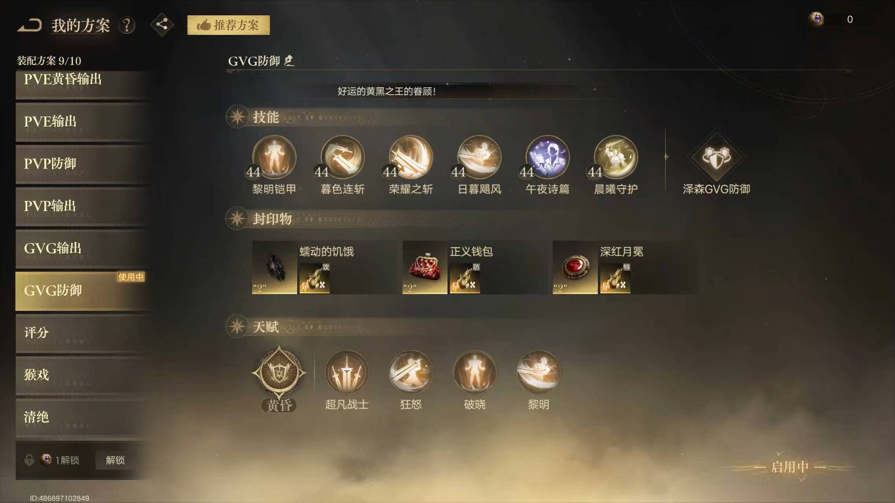
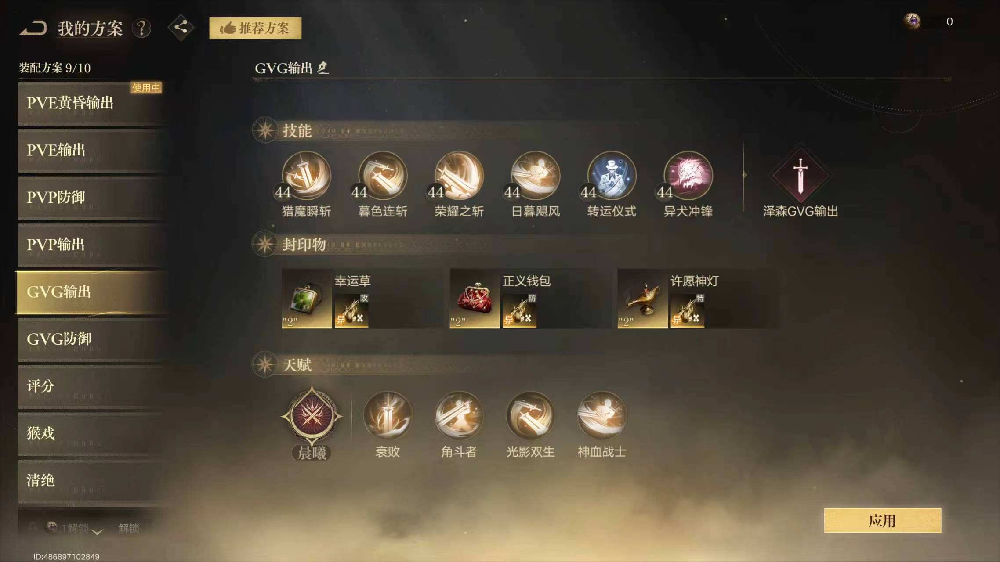
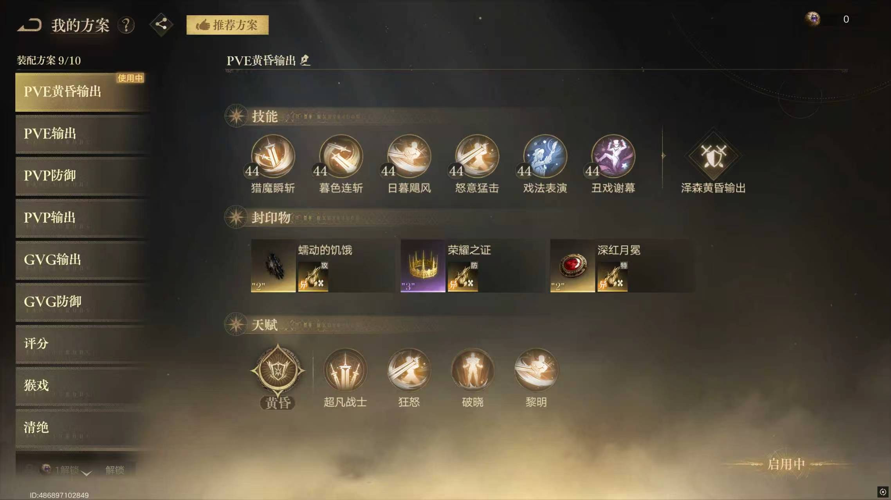
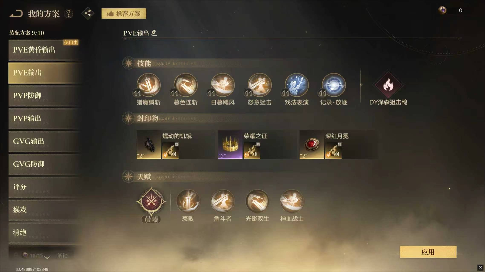
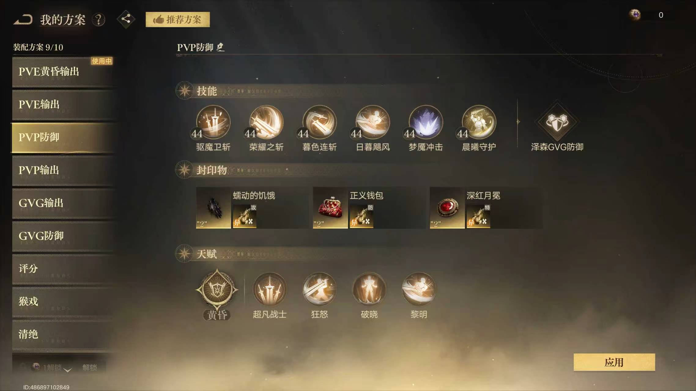
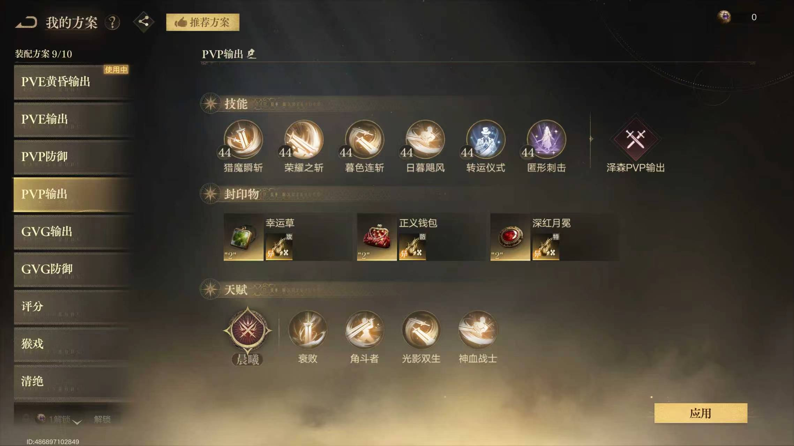

# 《诡秘之主》GVG 战士攻略：防御与输出两套玩法

> 今天分享一下 GVG 战士的两套主流玩法：**防御流**和**输出流**。当前版本更推荐防御流。战士不需要一味追求个人伤害，核心任务是站在前排扛伤、聚敌和控场，为队友创造安全的输出环境。

## 一、防御战士：团队的“移动蛋壳”

防御战士是 GVG 中不可或缺的团队支柱。

如果要形容这个定位，我更愿意称它为“守护者”，而不是“黄昏战士”：始终顶在队伍最前方，把队友保护在自己身后，承担伤害并打乱敌方阵型。

### 技能搭配

核心技能根据操作习惯二选一：

- **黎明铠甲：**偏向稳定和生存，容错率更高，适合大多数玩家。
- **驱魔卫斩：**更考验手动操作，但机动性更强，玩法上限也更高。

其余三个通用技能建议固定携带：

- 日暮飓风
- 荣耀之斩
- 暮色连斩

### 人脉技能

推荐从以下技能中选择：

- 午夜诗篇
- 通灵仪式

可以根据队伍阵容、自身操作习惯和技能练度进行选择。

### 秘偶技能

优先推荐：**晨曦守护**。

晨曦守护可以配合战士自身的守护竖壁，为全队叠加双层护盾，进一步提升团队的整体承伤与生存能力。

### 封印物搭配

推荐携带：

- 蠕动
- 钱包
- 神灯／月冕二选一

第三件可以根据实际战场需求选择：更注重团队收益时选择神灯，需要其他功能或属性时则可以考虑月冕。

### GVG 防御配装参考

### 核心玩法

防御战士不需要追求个人击杀，真正的价值体现在以下几个方面：

1. 顶在队伍前排，承担敌方第一轮伤害。
2. 利用技能拉人、聚敌，破坏敌方阵型。
3. 控制关键目标，为队友创造集火机会。
4. 使用护盾保护队友，帮助团队扛过敌方爆发。
5. 注意与己方大团的距离，不要独自冲得过深。

> 防御战士的作用不是自己打多少伤害，而是让队友可以放心输出。

---

## 二、输出战士：以功能输出为主

当前版本中，输出战士相较防御战士略显弱势，但仍然可以作为功能型前排使用。

这套玩法不建议硬堆极限伤害，主要任务依然是进场拉人、打乱阵型和制造击杀机会。在承担部分伤害的同时补充输出即可。

### 技能搭配

推荐固定携带：

- 巨剑斩击
- 日暮飓风
- 荣耀之斩
- 暮色连斩

这套技能兼顾突进、聚敌和伤害，适合跟随团队进场，帮助队友处理被拉出的关键目标。

### 人脉技能

推荐选择：

- 满星克莱恩
- 阿兹克

优先使用星级和练度更高的选项，并根据队伍缺少的能力进行调整。

### 秘偶技能

推荐从以下技能中选择：

- 匿形刺击
- 猛犬突进
- 牌雨

匿形刺击和猛犬突进更适合强化进场与追击能力；牌雨则可以补充范围伤害。根据自身练度以及对局需求选择即可。

### 封印物搭配

推荐携带：

- 面具
- 皇冠
- 月冕

整体以补充输出和功能性为主，但不要为了追求面板伤害而完全放弃生存。战士只有站得住，才能完成后续的拉人和控场。

### GVG 输出配装参考

### 核心玩法

1. 跟随己方大团推进，不要单独绕后或盲目进场。
2. 优先拉出敌方脆皮或关键角色，为队友制造集火机会。
3. 不必执着于亲自完成击杀，成功打乱阵型同样有价值。
4. 进场后边扛伤边补输出，血量危险时及时回到己方阵型。
5. 根据技能冷却决定进退，避免在没有自保手段时深入敌方大团。

---

## 三、两套玩法怎么选？

| 流派 | 团队定位 | 主要优势 | 推荐人群 |
| --- | --- | --- | --- |
| 防御战士 | 前排承伤、护盾保护、聚敌控场 | 团队价值高，容错稳定 | GVG主力战士、大多数玩家 |
| 输出战士 | 拉人开团、打乱阵型、功能输出 | 能够补充伤害，玩法更主动 | 装备练度较高、喜欢进攻的玩家 |

当前版本更推荐防御战士。如果队伍前排充足、个人练度较高，也可以选择输出流补充功能伤害。

---

## 四、六套完整配装图鉴

以下为 PVE、PVP 和 GVG 的六套完整配装方案。具体技能与封印物可以根据账号练度、队伍阵容和实际对局灵活调整。

### 1. PVE 黄昏输出

### 2. PVE 输出

### 3. PVP 防御

### 4. PVP 输出

### 5. GVG 输出

### 6. GVG 防御

---

## 五、总结

当前版本的 GVG 战士，更推荐以防御玩法为主。

无论选择防御还是输出，都不需要盲目追求伤害。战士最重要的任务，是站在前排拉人、聚敌和扛伤，帮助队友创造击杀机会。

> 防御战士是团队的盾，输出战士是撕开敌方阵型的矛。配装决定基础强度，进场时机和团队配合才真正决定实战上限。

[具体文档链接](https://docs.qq.com/doc/DYWxWUGFiQWJQa3FD)

---

*游戏版本可能影响技能、秘偶及封印物强度。本攻略仅代表个人实战思路，请结合自身账号练度与队伍阵容灵活调整。*
