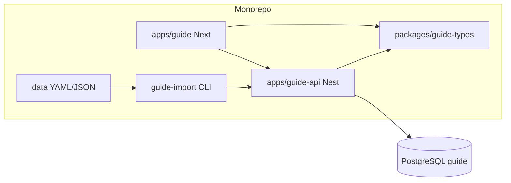

# 技术设计 · Guide（游戏配装资料站）

依据 [需求梳理版](../detail/需求-guide-梳理版.md)、[原始需求](../requirements/guide.md)。**本稿只定方案，不改代码。**

## 1. 目标与约束

| 项 | 结论 |
|---|---|
| 产品 | 实用型配装 + 连招工具；Wiki 少量支撑页 |
| MVP | 核心路径 U1–U6；1 个途径演示数据 |
| 团队 | 一人；数据 Git 维护 + 导入 CLI |
| 与 OCR | 同 monorepo；**零业务耦合**；**独立 DB、独立 compose、独立域名（或子域）** |
| 前台 | `apps/guide` — **Next.js 15（App Router）**，`output: 'standalone'` |
| 后端 | `apps/guide-api` — **NestJS 10**，全局前缀 `/api/v1` |
| 数据 | `prisma/guide/schema.prisma`（**不**并入根目录 OCR schema） |
| 类型 | `packages/guide-types`（DTO、枚举、配装计算纯函数，供前后端复用） |

**待澄清项默认**（梳理 §7，实现可按此开工，后续可改配置）：

| ID | 默认 |
|---|---|
| T1 站名 | 中文名「途径配装助手」；`<title>` 与页脚含「非官方粉丝工具」 |
| T2 分享 | **短 ID 存库** + 公开只读 API；URL 形如 `https://{APP_HOST}/s/{shareId}` |
| T3 访问形态 | **`https://wiki.wuyouclub.online`** 根站；见 §8.1 |
| T4 途径 | 7 途径自 `docs/游戏资料` 导入；`/build` 默认 landing 途径可配置 |
| T6 装备 | **游戏内实测 → `data/gear/*.yaml`**，与解包并行 import |
| T5 导入 | 本地/CI：`pnpm guide:import`；生产发布：`migrate deploy` + `guide:import`（需 `GUIDE_IMPORT_TOKEN` 或仅容器内 CLI） |

约束：

- 不做战斗模拟；属性仅为 **词条加总 + 简单权重规则**（规则 JSON 随版本导入）。
- 首版 **无用户注册**；写库仅导入脚本与（可选）带 Token 的内部接口。
- CORS 仅允许 `GUIDE_WEB_ORIGIN`。
- 合规：全站布局含免责声明组件；内容字段禁止存大段官方文案。

## 2. 总体架构

```text
浏览器
  https://{APP_HOST}          (Next.js SSR/SSG/CSR)
       │  GET 页面 /s/[id] /pathways/[slug] /gear/[slug] …
       │  GET/POST /api/v1/*  (经 Nginx 反代)
       ▼
  Nginx (guide 专用 compose)
       ├─ /api/  → guide-api:3001
       └─ /      → guide-web:3000 (Next standalone)

guide-api (NestJS)
  modules: health, meta, pathways, gear, skills, loadouts, shares, import (internal)
       │
       ▼
  PostgreSQL (库名 guide，与 OCR 分离)

Git: apps/guide-api/data/**  ──►  scripts/guide-import.ts (tsx)
                                      │
                                      └── upsert → PostgreSQL

可选：COS/CDN（Wiki 图）— 与 OCR 活动页共用桶 `guide-1503889614` 时，仅用对象前缀如 `/wiki/` 与 `/20261027/` 区分
```



## 3. 仓库布局（新增）

```text
apps/guide/                 # Next.js 前台
apps/guide-api/             # NestJS + Prisma client (guide schema)
packages/guide-types/       # 共享类型与 calcLoadoutStats()
prisma/guide/
  schema.prisma
  migrations/
apps/guide-api/data/        # 版本化静态数据源（Git）
  manifest.yaml             # 当前 gameVersion、核验日期、数据文件列表
  versions/
  pathways/
  skills/
  gear/
  loadouts/                 # 推荐方案
  rules/                    # 属性汇总规则
scripts/
  guide-import.ts           # 校验 + upsert（根 package.json 挂 guide:import）
deploy/
  docker-compose.guide.yml
  Dockerfile.guide-api
  Dockerfile.guide
  nginx.guide.https.conf
  .env.guide.production.example
```

根 `package.json` 脚本（规划）：

| 脚本 | 作用 |
|---|---|
| `dev:guide` | 并行或分别启动 guide-api + guide dev |
| `dev:guide-api` | `pnpm --filter @ocr/guide-api dev` |
| `build:guide` | types → api → next build |
| `guide:prisma:generate` | `prisma generate --schema prisma/guide/schema.prisma` |
| `guide:prisma:migrate` | migrate dev（guide） |
| `guide:import` | `tsx scripts/guide-import.ts` |
| `guide:import -- --dry-run` | 只校验不写库 |

## 4. 数据模型（Prisma · `prisma/guide/schema.prisma`）

所有游戏内容实体 **必须** 关联 `GameVersion`（或冗余 `versionId` + `verifiedAt`）。同一 slug 在不同版本为多行，或采用 `(slug, versionId)` 唯一。

### 4.1 元数据

**GameVersion**

| 字段 | 类型 | 说明 |
|---|---|---|
| id | UUID | |
| semver | String | 如 `1.0.3` |
| label | String? | 展示用 |
| releasedAt | DateTime? | |
| isCurrent | Boolean | 仅一条 true；导入时切换 |
| createdAt | DateTime | |

**DataProvenance**（可嵌在实体上，首版各表冗余字段即可）

- `sourceNote` String — 来源说明  
- `verifiedAt` DateTime — 最后核验  
- `isStale` Boolean @default(false) — 是否标记过期  

### 4.2 游戏内容

**Pathway**（途径/职业）

| 字段 | 说明 |
|---|---|
| id, versionId, slug, name | slug 全局唯一 per version |
| description | 短描述，非官方措辞 |
| sortOrder | |

**PlayScenario**（玩法场景：PVE / PVP / 战略服等）

| 字段 | 说明 |
|---|---|
| id, versionId, code, name | code 如 `PVE` |

**Skill**

| 字段 | 说明 |
|---|---|
| id, versionId, slug, name, pathwayId? | |
| skillType | enum: ACTIVE, PASSIVE, ULT, … |
| cooldownMs?, energyCost? | 可选，首版展示用 |
| tags | String[] 或 JSON |
| sourceNote, verifiedAt, isStale | |

**Gear**（装备）

| 字段 | 说明 |
|---|---|
| id, versionId, slug, name | |
| slot | enum: HEAD, CHEST, WEAPON, … |
| rarity | enum |
| baseStats | Json — `{ "attack": 100, "crit": 0.05 }` |
| affixes | Json — 词条列表 |
| setId? | FK GearSet |
| restrictions | Json? — 途径/场景限制 |
| sourceNote, verifiedAt, isStale | |

**GearSet** — 套装 id、名称、件数效果 Json。

**SealItem**（封印物，首版可表结构预留、数据可为空）

**RecommendedLoadout**（官方/作者推荐方案，来自 Git）

| 字段 | 说明 |
|---|---|
| id, versionId, slug, title | |
| pathwayId, scenarioId | |
| gearSlots | Json — `{ "WEAPON": "gear-slug", ... }` |
| skillBar | Json — 技能 slug 顺序 |
| comboSteps | Json — 见下 |
| notes | String? |
| sourceNote, verifiedAt | |

**comboSteps JSON 形状**

```json
[
  { "skillSlug": "skill-a", "label": "起手" },
  { "skillSlug": "skill-b", "label": "衔接" }
]
```

### 4.3 用户分享

**SharedBuild**

| 字段 | 说明 |
|---|---|
| id | 短 ID，如 nanoid 8–10 字符，**唯一** |
| versionId | 创建时当前版本 |
| pathwayId, scenarioId | |
| gearSlots | Json — 与推荐方案同结构 |
| comboSteps | Json |
| title | String? 用户可选 |
| createdAt | DateTime |
| expiresAt | DateTime? 首版可 null（永不过期） |

索引：`@@unique([id])`，`@@index([createdAt])`。

### 4.4 导入审计（可选 Must for 一人维护）

**ImportRun**

| 字段 | 说明 |
|---|---|
| id, startedAt, finishedAt | |
| manifestHash | 本次 data 目录 hash |
| gameVersion | |
| status | SUCCESS / FAILED |
| log | String? |

## 5. Git 数据格式与导入

### 5.1 `manifest.yaml`

```yaml
gameVersion: "1.0.0"
verifiedAt: "2026-10-28"
sourceNote: "游戏内实测 + 公告"
files:
  - pathways/demo.yaml
  - gear/*.yaml
  - skills/demo.yaml
  - loadouts/demo-pve.yaml
  - rules/stats-v1.json
```

### 5.2 单文件示例 `pathways/demo.yaml`

```yaml
slug: demo
name: 演示途径
description: 占位；替换为真实途径名
sortOrder: 1
```

### 5.3 导入流程

1. 读取 manifest，Zod 校验各文件 schema。  
2. `--dry-run`：只报告错误与将 upsert 的计数。  
3. 事务内：设置新版本 `isCurrent`（若 manifest 声明新版本）；按 slug upsert 各表。  
4. 删除 **不在 manifest 且标记为 import-managed** 的行（可选，首版可只 upsert 不删）。  
5. 写入 `ImportRun`。

导入实现位置：`scripts/guide-import.ts` 调用 `@ocr/guide-api` 内 `ImportService`（或独立 `packages/guide-importer`），需 `DATABASE_URL` 指向 guide 库。

### 5.4 解包资料导入（`docs/游戏资料/`）

依据 [叨叨诡秘助手-v0.4.1b-解包说明](../游戏资料/叨叨诡秘助手-v0.4.1b-解包说明.md)。**只读仓库内 JSON/CSV，不执行助手 EXE/DLL。** 数据非官方，导入时 `sourceNote` 固定包含助手版本与 `client_build`（见 `_release_identity.json`）。

| 源文件 | 目标实体 | 映射要点 |
|---|---|---|
| `skill_metadata.json` → `professions` | `Pathway` | key `1200001`… → `externalId`；`name` → 展示名；`slug` 建议 `sun` 等拼音或 `p-1200001` |
| 同上 → `professions[].skill_ids` | `Skill` + 关联 | 技能 `slug` = `s-{id}`；仅 metadata 有的 id 建技能行 |
| `skill_names.json` | `Skill.name` | id 字符串 key → 名称；无 metadata 的 id **首版忽略**（避免 5609 全灌入污染） |
| `skill_metadata.json` → `skills` | 图标等 | 仅 `icon_path`（UE 路径）→ 存 `iconRef`，**不**下载助手 PNG |
| `map_catalog_20260918.csv` | `PlayScenario` | 按 `mode_category`（PVE/PVP/…）去重生成 `code`；副本名供后续 Wiki |
| `monster_metadata.json` | （Phase 2） | 暂不导入 MVP |
| `boss_enrage_config.json` | （Phase 2） | 暂不导入 MVP |
| **（无文件）全量装备** | `Gear` | **不自动**；见 5.5 |

**技能类型推断（首版启发式）**：id 段 `860xxxxx` 且出现在某途径 `skill_ids` → `ACTIVE`/`PASSIVE` 可再按 id 末位或名称含「被动」细分；不确定则 `UNKNOWN`，UI 仍可做连招排序。

**版本号**：`manifest.yaml` 的 `gameVersion` 建议填 `_release_identity.json` 的 `client_build`（如 `0.4.1+20261025.2`），`verifiedAt` 取导入日或 `generated_at_utc`。

### 5.5 装备与配装（修订 · T6 已确认）

解包结论：**无独立全量装备目录**。`80001xxx` 等名称**不**作为装备 YAML 自动生成来源。

**首版策略（已定）**：维护者在 **游戏客户端内核对** 名称、槽位、基础属性、可见词条后，写入 Git：

`apps/guide-api/data/gear/{pathway-slug}.yaml`（或按槽位分文件，importer 合并）。

建议单件 YAML 字段（与 Prisma `Gear` 对齐）：

```yaml
- slug: sun-wpn-001          # 英文/拼音唯一键
  name: "装备游戏内全称"
  slot: WEAPON                 # HEAD | CHEST | WEAPON | ...
  rarity: LEGENDARY
  pathwaySlugs: [sun]          # 可选限制
  baseStats:
    attack: 120
    critRate: 0.08
  affixes:
    - label: "词条名"
      stats: { critRate: 0.03 }
  sourceNote: "游戏内面板 2026-10-28，角色 XX，版本 client_build …"
  verifiedAt: "2026-10-28"
```

| 项 | 约定 |
|---|---|
| 首版数量 | **每途径 5～15 件**（覆盖主要槽位即可）；优先录入该途径「推荐配装」会用到的件 |
| `RecommendedLoadout` | `gearSlots` 引用上述 slug；`comboSteps` / `skillBar` 可与解包技能 id 对应 |
| `loadouts/*.yaml` | 至少 1 套/途径（或 1 套演示途径）含完整 gearSlots，供 U2 |
| 发布门禁 | `guide:import --dry-run` 校验：**当前版本下至少 1 途径 gear 文件非空** |
| 后续扩展 | 仍可在版本更新时继续 YAML 增量；DLL/抓包为 **可选加速**，非 MVP 依赖 |

**属性汇总**：仅对 YAML 中 `baseStats` / `affixes` 做 `calcLoadoutStats`；录入错误由 `verifiedAt` + 站内版本条提示复核。

**生产**：镜像 entrypoint 在 `SEED_GUIDE=true` 时执行 migrate + import；或 SSH 执行 `docker compose run --rm guide-api pnpm guide:import`。

## 6. 属性汇总（`packages/guide-types`）

纯函数，无 IO：

```typescript
// 输入：gearSlots + Gear[] + StatRules
// 输出：{ stats: Record<string, number>, warnings: string[] }
export function calcLoadoutStats(...)
```

- `StatRules` 来自 `rules/stats-v1.json`（如暴击率上限、百分比加算方式）。  
- **非法组合**（restrictions 不满足）：warnings 含可读原因，前台 Toast/Alert。  
- Next 配装页：**客户端实时计算**（数据已在页面 SSR 时注入或 React Query 拉取），满足「交互 < 200ms」。

## 7. guide-api 模块与接口

全局前缀 `/api/v1`。公开读接口 **无 JWT**；写分享 **无 JWT**（首版接受滥用风险，可 Accelerate 限流后续加）。

### 7.1 健康与元信息

| 方法 | 路径 | 说明 |
|---|---|---|
| GET | `/health` | `{ status: "ok" }` — Docker healthcheck |
| GET | `/meta/current-version` | 当前 `GameVersion` + `verifiedAt` |

### 7.2 只读内容（支撑 U1–U2、U7）

| 方法 | 路径 | 说明 |
|---|---|---|
| GET | `/pathways` | 当前版本途径列表 |
| GET | `/pathways/:slug` | 详情 + 关联场景 |
| GET | `/scenarios` | 玩法场景列表 |
| GET | `/gear` | Query: `pathway`, `slot`, `page` |
| GET | `/gear/:slug` | 单件装备（SEO 页数据源） |
| GET | `/skills` | Query: `pathway` |
| GET | `/skills/:slug` | 单技能 |
| GET | `/loadouts` | Query: `pathway`, `scenario` |
| GET | `/loadouts/:slug` | 推荐配装 + comboSteps |

响应 DTO 统一在 `packages/guide-types` 定义，与 OCR `@ocr/shared-types` **不合并**。

### 7.3 分享（U6）

| 方法 | 路径 | 说明 |
|---|---|---|
| POST | `/shares` | Body: `{ pathwaySlug, scenarioCode, gearSlots, comboSteps, title? }` → `{ id, urlPath }` |
| GET | `/shares/:id` | 还原完整 build；404 无效 id |

Next 页 `/s/[id]`：SSR 调 `GET /shares/:id`，meta 含 `noindex` 可选（用户分享页可不索引）。

### 7.4 内部导入（T5）

| 方法 | 路径 | 说明 |
|---|---|---|
| POST | `/internal/import` | Header: `Authorization: Bearer ${GUIDE_IMPORT_TOKEN}` — 触发与 CLI 相同逻辑（可选；首版可仅 CLI） |

## 8. Next.js 路由（`apps/guide`）

| 路由 | 渲染 | 说明 |
|---|---|---|
| `/` | SSG | 首页 + 免责声明 + 当前版本条 |
| `/pathways` | SSG/ISR | 途径列表 U1 |
| `/pathways/[slug]` | ISR revalidate 3600 | 入口 → 链到配装工作台 |
| `/build` | CSR + SSR shell | Query: `pathway`, `scenario`, `loadout?` — **主工作台** U2–U5 |
| `/gear/[slug]` | ISR | 装备百科 U7 |
| `/skills/[slug]` | ISR | 技能百科 U7 |
| `/s/[id]` | SSR | 分享落地 U6 |
| `/legal/disclaimer` | SSG | 合规 |
| `/legal/takedown` | SSG | 侵权投诉说明 + 联系邮箱 env |

环境变量：

- `GUIDE_API_URL` — 服务端 fetch 用（Docker 内网 `http://guide-api:3001`）  
- `NEXT_PUBLIC_GUIDE_API_URL` — 浏览器用（`/api` 同源则可为空，经 Nginx 反代）

### 8.1 域名与 Nginx（单独部署）

**冲突说明**：现网 `deploy/.env.production.example` 中 **`guide.wuyouclub.online` 已作为 COS 自定义域名**（活动页静态媒体）。若将 Next 也绑在同一主机名，会与 CDN 源站策略冲突。

**推荐**：

| 用途 | 主机名 |
|---|---|
| 配装站前台 + API 反代 | **`wiki.wuyouclub.online`** |
| OCR 活动页 COS | 保持 **`guide.wuyouclub.online`** 指向腾讯云 CDN |

`deploy/nginx.guide.https.conf` 逻辑对齐 OCR `nginx.https.conf`：

- `location /api/` → `proxy_pass http://guide-api:3001/api/`（注意 Nest 全局前缀一致）  
- `location /` → `proxy_pass http://guide-web:3000`  

证书：Certbot 为 `wiki.wuyouclub.online` 单独申请（或与主域 SAN 证书）。

`docker-compose.guide.yml` 服务：

- `postgres-guide`（卷独立）  
- `guide-api` — PORT 3001，`DATABASE_URL`，`GUIDE_WEB_ORIGIN=https://wiki.wuyouclub.online`  
- `guide-web` — PORT 3000，`GUIDE_API_URL=http://guide-api:3001`

**与 OCR compose**：不同文件、不同 `.env.guide.production`、不同服务器端口映射均可；同一台机部署时用不同 `HTTP_PORT`/`HTTPS_PORT` 或独立 VM。

## 9. 安全与限流

| 项 | 首版 |
|---|---|
| 分享 POST | 无鉴权；Body 大小限制 32KB；字段 whitelist |
| 导入 | 仅 CLI 或 Bearer Token |
| CORS | 仅 GUIDE_WEB_ORIGIN |
| Rate limit | 可选 nginx `limit_req` on `POST /api/v1/shares` |

## 10. 技术选型与备选

| 决策 | 选型 | 备选 |
|---|---|---|
| 前台框架 | Next.js App Router | Nuxt 3（SEO 同样好，但与「2D Next + Nest」决策不一致） |
| ORM | Prisma 独立 schema | Drizzle（无必要双栈） |
| 数据编辑 | YAML + Git | 直接 SQL seed（不利于 diff） |
| 搜索 | PG `ILIKE` | Meilisearch（Could） |
| 分享 | DB 短 id | URL gzip base64（过长，弃用） |

## 11. 用例追溯

| 用例 | 前台 | API | 数据 |
|---|---|---|---|
| U1 | `/pathways`, `/build` | GET pathways, scenarios | pathways/*.yaml |
| U2 | `/build?loadout=` | GET loadouts/:slug | loadouts/*.yaml |
| U3 | `/build` 装备选择器 | GET gear | gear/*.yaml |
| U4 | `/build` calcLoadoutStats | — | rules/*.json |
| U5 | `/build` 连招编辑器 | — | skills + 本地 state |
| U6 | `/s/[id]` | POST/GET shares | SharedBuild 表 |
| U7 | `/gear/[slug]`, `/skills/[slug]` | GET gear/skills | yaml |
| 版本展示 | Layout `VersionBar` | GET meta/current-version | manifest |

## 12. 风险与对策

| 风险 | 对策 |
|---|---|
| COS 与 App 子域冲突 | App 用 `wiki.`、COS 用 `guide.`；env 示例写清 |
| 一人双栈维护 | 最大化复用 Nest/Prisma 模式；guide-api 裁剪模块 |
| 分享 spam | 后加 IP 限流 + CAPTCHA |
| 数据空库上线 | CI/check：`guide:import --dry-run` 作为 gate |
| 版权 | 数据层 lint：description 长度上限；禁止字段名 `officialText` |
| 助手数据/美术 | 不打包助手 `assets/`；公网只用文字 ID+名称；声明第三方数据来源 |
| 装备长期缺失 | MVP 连招优先；装备 importer 单独立项 |

## 13. 文档映射

| 文档 | 路径 |
|---|---|
| 原始需求 | [docs/requirements/guide.md](../requirements/guide.md) |
| 需求梳理版 | [docs/detail/需求-guide-梳理版.md](../detail/需求-guide-梳理版.md) |
| 本文 | docs/design/技术设计-guide.md |
| 开发计划 | [docs/plan/开发计划-guide.md](../plan/开发计划-guide.md) |
| 自测方案 | [docs/test/自测方案-guide.md](../test/自测方案-guide.md) |

实现代码须用户 **另开开发任务**（脚手架 `apps/guide`、`apps/guide-api` 等）。
