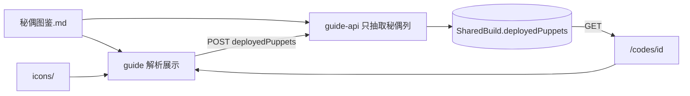

# 技术设计 · Wiki 分享与秘偶图鉴

依据 [需求梳理版](../detail/需求-wiki分享-梳理版.md)、[原始需求](../requirements/wiki分享.md)。**本稿只定方案，不改代码。**

梳理版 §8 的默认在本稿落死，实现按此开工：

| ID | 采纳 |
|---|---|
| T1 红色秘偶 | 不编造名单。品质只认资料表「品质」列；当前无红色行时，列表仍渲染红色分区，文案为「暂无数据」 |
| T2 路由 | `/puppets`、`/puppets/[name]` |
| T3 选择器 | 分品质 Tab + 搜索，无默认勾选 |
| T4 列表 | `ShareListItemDto` 本版不加秘偶字段；只在详情 `ShareDto` 返回名称数组 |

## 1. 目标与约束

在现有 Guide 上增量做两件事：秘偶图鉴（对标封印物 `/seals`），以及保存 wiki 分享时附带 0～3 个上阵秘偶。

| 项 | 结论 |
|---|---|
| 前台 | `apps/guide`（Next.js App Router）。图鉴读本地 Markdown + 图标，不进数据库 |
| 后端 | `apps/guide-api`。只扩展 `POST /shares`、`GET /shares/:id` |
| 库 | `prisma/guide/schema.prisma` 的 `SharedBuild` 加可空 JSON 列 |
| 类型 | `packages/guide-types` 的 `ShareCreateBody`、`ShareDto` |
| 分享通道 | 仅存库分享。不改 `parseGameSharePaste`、不改游戏分享文案、不改 MessagePack |
| 数量 | 0～3，去重后计数；不做「实际上阵 2 只」校验 |
| 默认 | 不预选 |
| 旧数据 | 列为 `null` 时详情返回 `[]`，页面不渲染秘偶区 |

两个进程镜像分离：图鉴正文和图标只进 **guide 镜像**（与 `data/seals` 相同）；API 只需要一份**名称白名单**，用来拒绝非法名称。白名单不单独手写，避免和表格漂移。

## 2. 总体架构

```text
浏览器
  /                  首页卡片 → /puppets
  /puppets           按红 / 橙 / 金 / 紫列表（读 Markdown）
  /puppets/[name]    详情
  /puppet-assets/*   图标
  /build             保存前多选 0～3 个名称
  /codes/[id]        详情展示已存名称，链到图鉴
       │
       │  POST /api/v1/shares          { ..., deployedPuppets?: string[] }
       │  GET  /api/v1/shares/:id      ShareDto.deployedPuppets: string[]
       ▼
guide-api
  校验长度、去重、名称 ∈ 白名单
  SharedBuild.deployedPuppets  Json?

Git
  apps/guide/data/puppets/秘偶图鉴.md     ← 展示与白名单的唯一正文
  apps/guide/data/puppets/icons/*.png
```



## 3. 模块职责

| 模块 | 路径 | 职责 |
|---|---|---|
| 图鉴根路径 | `apps/guide/src/lib/puppets-path.ts` | 解析数据目录。候选与封印物相同：`data/puppets`、`apps/guide/data/puppets`，以存在 `秘偶图鉴.md` 为准 |
| 图鉴解析 | `apps/guide/src/lib/puppets-catalog.ts` | 解析总表、品质归一、进阶小节；按名称取一条 |
| 图标 | `apps/guide/src/lib/puppets-manifest.ts` | 名称 → `icons/{名称}.png`。文件名即秘偶名（原稿 `秘偶icons/` 已是这个规则），缺文件返回占位，不抛错 |
| 列表 / 详情 | `apps/guide/src/app/puppets/page.tsx`、`puppets/[name]/page.tsx`、`puppets.css` | 对标 `seals`。详情 `generateStaticParams` 用 catalog 名称 |
| 静态资源 | `apps/guide/src/app/puppet-assets/[...path]/route.ts` | 复制 `seal-assets`：限制在数据根目录内，png/jpg/webp，`Cache-Control: public, max-age=86400` |
| 展示 | `apps/guide/src/components/puppets-display.tsx` | 对标 `SealsDisplaySection`。空数组不渲染。卡片链到 `/puppets/{encodeURIComponent(name)}` |
| 配装台 | `apps/guide/src/app/build/workbench.tsx` | 导入成功后出现选择器；`clearImport` 清空已选；保存时把数组放进 `POST /shares` |
| 分享详情 | `apps/guide/src/components/combo-share-detail.tsx` | 用 `share.deployedPuppets`，不从 `shareText` 解析 |
| 首页 | `apps/guide/src/app/page.tsx` 的 `FEATURES` | 「资料查询」增加「秘偶图鉴」卡片，插在「敬请期待」之前。不加顶栏 |
| DTO | `packages/guide-types/src/dto.ts` | 见 §6 |
| 入参校验 | `apps/guide-api/src/shares/create-share.dto.ts` + `shares.service.ts` | 形状用 class-validator；是否在册在 service 里对白名单查 |
| 白名单 | `apps/guide-api/src/shares/puppet-names.ts` | 只读 Markdown 第二列（秘偶名）。不复制整份图鉴解析 |
| 模型 | `prisma/guide/schema.prisma` | `deployedPuppets Json?` |

不改：`parseGameSharePaste`、连招码列表查询与 `ShareListItemDto`、配装属性计算、guide-api 导入脚本。

## 4. 图鉴数据

### 4.1 落盘

从 `docs/诡秘之主-秘偶图鉴` 拷入运行目录（docs 留档，**运行时只读 guide data**，避免两处改表）：

```text
apps/guide/data/puppets/
  秘偶图鉴.md          ← 原稿「诡秘之主-秘偶资料.md」
  icons/
    {秘偶名}.png       ← 原稿「秘偶icons/」30 张，与总表 30 行一一对应
```

当前总表没有红色行，图标也没有红色文件。补红色时只加表行和同名 png，不改解析代码。

镜像：`deploy/Dockerfile.guide` 增加与 seals 并列的一行：

```dockerfile
COPY --from=build /app/apps/guide/data/puppets ./apps/guide/data/puppets
```

漏拷贝时页面能开、图标全是占位。这是封印物已经踩过的点，发布检查要带上这一行。

### 4.2 总表解析

读 `## 秘偶总表` 下第一张 Markdown 表。列顺序固定为：

品质、秘偶、技能名称、技能1阶、冷却（秒）、释放射程（米）、作用半径（米）、属性1、属性2、定位、PVP/PVE、推荐与备注。

单元格按 `|` 切分后 trim。表头行和 `|---|` 分隔行跳过。单元格内不应再出现 `|`（现稿没有）。

品质归一：

| 单元格 | 内部值 | 展示 |
|---|---|---|
| 红色 | `red` | 红色 |
| 橙色、橙色（新增） | `orange` | 橙色 |
| 金色 | `gold` | 金色 |
| 紫色 | `purple` | 紫色 |
| 其他 | 丢弃该行 | 不进 catalog，也不能被分享选中 |

`—`、空字符串在详情里显示为「—」。数值列（冷却、射程、半径）保持原文，包含「待核验」「自身」「扇形…」，不做数值化。

内存结构（仅 guide 进程内）：

| 字段 | 来源 |
|---|---|
| `name` | 秘偶 |
| `rarity` | 归一后的品质 |
| `skillName` / `skillRank1` | 技能名称 / 技能1阶 |
| `cooldown` / `castRange` / `radius` | 三列原文 |
| `attr1` / `attr2` / `role` / `mode` / `note` | 属性、定位、PVP/PVE、推荐与备注 |
| `ranks` | 见下，可缺省 |

### 4.3 进阶

`## 新增秘偶进阶效果` 下，`### {名称}｜{技能名}` 挂到同名秘偶。列表项 `- **N阶：**正文` 收成 `{ rank, text }[]`。对不上名称的小节忽略。没有进阶的秘偶详情不渲染该区块。

`## 使用说明` 整段作为列表页顶部说明（含「可上阵 2 只、未上阵 35%」）。只展示，不参与保存校验。

### 4.4 列表分区

固定顺序：红、橙、金、紫。每档都渲染标题。该档 0 条时显示「暂无数据」，不隐藏标题。卡片：图标（或占位）+ 名称，链到详情。详情字段与上表一致；有 `ranks` 时按阶展示。

## 5. 数据模型

`SharedBuild` 增加：

```prisma
/// 上阵秘偶名称，0～3 个，顺序为用户选择顺序。旧分享为 null
deployedPuppets Json?
```

- 不建关联表。名称没有独立查询，0～3 个字符串用 JSON 数组足够，也和本 schema 里现有的 `Json` 列一致。
- 不回填。存量行保持 `null`。
- 新写入：有选择时写入去重后的 `string[]`；没选写入 `[]`（与 `null` 在读模型里都变成空数组）。
- 不加索引。

迁移只加可空列，放在 `prisma/guide/migrations/`。改源 schema `prisma/guide/schema.prisma`，不要手改 `apps/guide-api/src/generated`。

## 6. 接口

全局前缀仍是 `/api/v1`。路由不变。

### 6.1 `POST /shares`

`CreateShareDto` / `ShareCreateBody` 增加可选字段：

```ts
deployedPuppets?: string[]
```

校验顺序：

1. 缺省视为 `[]`。
2. 必须是字符串数组；元素 trim 后非空，单名最长 40。
3. **去重前**长度 ≤ 3。第 4 个直接 400，不靠去重把 4 个收成 3 个。
4. 去重且保持先出现的顺序。
5. 每个名称必须出现在白名单（与资料表「秘偶」列 trim 后全等）。
6. 失败 `400`，文案说明是数量、空名还是「未知秘偶：{name}」。其余原有校验（途径、文案、标题）不变。

成功体不变：`{ id, urlPath }`，`urlPath` 仍是 `/codes/{id}`。

### 6.2 `GET /shares/:id`

`ShareDto` 增加必填：

```ts
deployedPuppets: string[]
```

映射：`Array.isArray(row.deployedPuppets) ? 过滤成字符串 : []`。非法 JSON 当成 `[]`，避免旧脏数据把详情打成 500。

### 6.3 列表与删除

`GET /shares` 的 `ShareListItemDto` 不加字段。`DELETE /shares/:id` 不变。

### 6.4 白名单怎么进 API 镜像

正文只放在 `apps/guide/data/puppets/秘偶图鉴.md`。`deploy/Dockerfile.guide-api` 的 **build** 阶段多拷一份到 API 数据目录（runtime 已有 `COPY .../apps/guide-api/data`，因此 build 阶段写入即可）：

```dockerfile
COPY apps/guide/data/puppets/秘偶图鉴.md apps/guide-api/data/puppets/秘偶图鉴.md
```

`puppet-names.ts` 按序找第一个存在的文件：

| 场景 | cwd | 路径 |
|---|---|---|
| 容器 | `/app` | `apps/guide-api/data/puppets/秘偶图鉴.md` |
| 本地 API | `apps/guide-api` | `../guide/data/puppets/秘偶图鉴.md` |
| 仓库根目录启动 | 仓库根 | `apps/guide/data/puppets/秘偶图鉴.md` |

找不到文件时，创建分享若带了非空 `deployedPuppets` 则 400「秘偶名册不可用」；空数组仍允许保存（图鉴挂了不应该挡住不带秘偶的分享）。进程内缓存名称集合，改文件需重启，与封印物 catalog 的进程内缓存同一级别。

抽取规则：同一张总表、同一列、同样跳过表头；不解析进阶、不解析品质。这样 API 与页面使用同一份「秘偶」单元格。

## 7. 关键流程

### 7.1 浏览图鉴

首页卡片 → `/puppets` → 服务端 `loadPuppetCatalog()` → 四档分区 → `/puppets/{name}`。未知名称 `notFound()`。

### 7.2 保存分享

1. 配装台粘贴文案、解析成功（现有逻辑）。
2. 选择器默认 `[]`。Tab 为当前品质，搜索只过滤当前 Tab 的名称。
3. 点选切换；已选 3 个再点第 4 个时不加入，行内提示已满。
4. `POST /shares` 体在现有 `pathwaySlug`、`scenarioCode`、`shareText`、`title` 上增加 `deployedPuppets`。
5. 成功仍 `router.push(urlPath)`。
6. `clearImport` 同时清空已选秘偶。

选择器数据来自 guide 的 catalog，不请求新接口。

### 7.3 打开旧分享

`deployedPuppets` 为 `null` 或 `[]` → `PuppetsDisplaySection` 返回 `null`。封印物区仍只来自文案解析，两边互不影响。

## 8. 技术选型

| 决策 | 选择 | 放弃的做法 |
|---|---|---|
| 秘偶存在哪 | `SharedBuild` 上可空 `Json` 字符串数组 | 关联表：没有按秘偶筛选的需求，多一张表和迁移不值 |
| 名称校验 | API 读同一份 Markdown 的秘偶列 | 再维护 `names.json`：多一个易忘的同步文件 |
| 图标映射 | `icons/{名称}.png` 约定 | 手写 manifest：原稿文件名已经是秘偶名 |
| 品质 UI | 四档都渲染，空档「暂无数据」 | 没数据就隐藏红色：验收要求看得到红色分区 |
| 列表接口 | 本版不带秘偶 | 列表带图标会扩大 DTO，梳理版定为 Should，首版不做 |
| 路由 | `/puppets` | `/marionettes`、中文路径 |

品质色用边框 / 标签区分即可，具体色值实现时与现有暗色背景对齐：红、橙、金、紫四色，同一档列表和详情用同一套 class（如 `puppet-rarity--red`）。

## 9. 风险与对策

| 风险 | 对策 |
|---|---|
| API 镜像没拷到 Markdown，非空秘偶全部 400 | Dockerfile 明确一行；自测先打一条带秘偶的 `POST /shares` |
| guide 镜像没拷 `data/puppets`，图标 404 | 与 seals 相同的 runtime `COPY`；缺图走占位，页面仍可开 |
| 总表改了列顺序，解析错位 | 解析按表头文字认列，不按序号硬绑；表头缺「秘偶」或「品质」时该行丢弃 |
| 红色长期为空 | 分区仍在；补数据只改 md + png |
| 详情 URL 含 `·` | 与封印物一样 `encodeURIComponent`，动态段用解码后的名称查 catalog |
| 旧客户端不传新字段 | 字段可选，按 `[]` 处理 |

## 10. 与梳理版追溯

| 用例 | 设计落点 |
|---|---|
| P1 首页入口 | `FEATURES` 增加 `/puppets` |
| P2 四档列表 | §4.4，空的红色档显示「暂无数据」 |
| P3 详情 | §4.2 字段 + §4.3 进阶 |
| P4 保存时 0～3、无默认 | §6.1、§7.2 |
| P5 详情展示并可跳转 | `PuppetsDisplaySection` + `/puppets/[name]` |
| P6 列表感知 | 本版不做 |
| P7 旧分享 | `null` → `[]`，区块不渲染 |
| P8 解析游戏文案 | 不改 `parseGameSharePaste` |

验收 1～5 分别对应 P1–P3、P4、P5、P7。验收 6 只核对 `POST /shares` 与 `GET /shares/:id`：不选、选 1～3 个合法名、第 4 个、非法名、旧 id 的空数组。

## 11. 文档映射

| 文档 | 路径 | 状态 |
|---|---|---|
| 原始需求 | `docs/requirements/wiki分享.md` | 已存在 |
| 需求梳理版 | `docs/detail/需求-wiki分享-梳理版.md` | 已完成 |
| 技术设计 | `docs/design/技术设计-wiki分享.md` | 本文 |
| 开发计划 | `docs/plan/开发计划-wiki分享.md` | 已完成 |
| 自测方案 | `docs/test/自测方案-wiki分享.md` | 已完成 |
