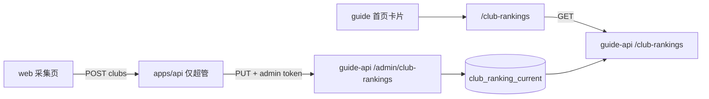

# 技术设计 · 俱乐部数据采集

依据 [需求梳理版](../detail/需求-俱乐部数据采集-梳理版.md)、[原始需求](../requirements/俱乐部数据采集.md)。**本稿只定方案，不改代码。**

梳理版待澄清的暂定在本稿落死：

| ID | 采纳 |
|---|---|
| Q1 路径 | Guide 排行页 `/club-rankings` |
| Q2 空数组 | `clubs` 长度为 0 时 400，不覆盖已有排行 |
| Q3 条数 | 1～200 条，超出 400 |
| Q4 首页 | 放进现有「资料查询」功能卡片，标题「俱乐部排行」，插在「敬请期待」之前 |

评分千分位（梳理版 Could）一并采纳：库存整数，页面显示时加分隔符。

## 1. 目标与约束

超管在 OCR 后台上传 JSON，浏览器只抽出 `clubs` 写入 Guide 库的当前排行。Guide 访客打开 `/club-rankings` 看到这六列。`rank.png` 只决定深色表格的样子，不参与识别，也不进页面。

| 项 | 结论 |
|---|---|
| 写入方 | `apps/web` 采集页，仅超管 |
| 代理 | `apps/api` 验超管后，用 `GUIDE_ADMIN_TOKEN` 转发到 guide-api。浏览器不持有该 Token |
| 存储 | `prisma/guide` 新增一张当前榜。不写 OCR 库的 `Club` / `Member` |
| 读取方 | `apps/guide` 服务端请求公开 `GET /club-rankings` |
| 覆盖 | 校验通过后整份替换。校验失败保持原行不变 |
| 历史 | 不保留上一份 |
| 展示字段 | 仅 `rank`、`name`、`server`、`leader`、`memberCount`、`score` |

可行性：样例 `docs/俱乐部数据/club-ranking-2026-11-03.json` 的 `clubs` 为 50 条，六字段齐全，体积远小于接口限制。现成链路是 Wiki 内容管理（`apps/api` 的 `WikiAdminService` → guide-api `/admin/*`）。排行接口目前不存在，按同一模式新增即可。

## 2. 总体架构

```text
超管浏览器（apps/web）
  选择 .json → JSON.parse → 只取 clubs → 本地校验
       │  POST /api/v1/club-rankings     Authorization: 登录 JWT
       ▼
apps/api
  仅 isSuper
  再校验 clubs
       │  PUT /api/v1/admin/club-rankings   Bearer GUIDE_ADMIN_TOKEN
       ▼
guide-api
  GuideAdminTokenGuard
  事务内 upsert 当前榜
       │
       ▼
Guide Postgres   club_ranking_current（一行，clubs 为 JSON）

访客（apps/guide）
  首页卡片 → /club-rankings
       │  GET /api/v1/club-rankings     无登录
       ▼
  服务端渲染六列表格；无行时显示「暂无排行」
```



OCR 的俱乐部人员表不在这条链上。

## 3. 模块职责

| 模块 | 路径 | 职责 |
|---|---|---|
| 超管菜单 | `packages/shared-types/src/index.ts` | `MENU_CATALOG` 的「系统管理」增加 `{ key: 'club-ranking-import', title: '俱乐部数据采集', path: '/club-ranking-import' }`。新增 `SUPER_ONLY_MENU_KEYS = ['club-ranking-import']` |
| 角色分配 | `apps/web/src/views/Roles.vue`、`apps/api/src/roles/roles.service.ts` 的 `cleanMenus` | 可勾选列表去掉超管专属项。`cleanMenus` 遇到该 key 直接 400，避免接口绕过勾选框写入 |
| 路由 | `apps/web/src/router.ts` | 子路由 `club-ranking-import`，`meta.menu = 'club-ranking-import'`。侧栏数据仍来自 `menusForKeys`：超管的 `menuKeys` 含全部目录项，所以能看见；普通角色没有该 key，直接打开地址会被送回已有菜单 |
| 采集页 | `apps/web/src/views/ClubRankingImport.vue`、`apps/web/src/api/client.ts` | 文件选择、解析、预览行数、提交、成功提示条数 |
| 代理 | `apps/api/src/club-rankings/` | `POST /club-rankings`。先要求 `user.isSuper`，再转发。不用「有菜单就能写」的 `RequireMenu`，防止库里残留菜单行 |
| 公开读 | `apps/guide-api/src/club-rankings/` | `GET /club-rankings` |
| 管理写 | `apps/guide-api/src/admin/admin.controller.ts` | `PUT /admin/club-rankings`，沿用 `GuideAdminTokenGuard` |
| 模型 | `prisma/guide/schema.prisma` + 新 migration | 见 §5 |
| DTO | `packages/guide-types` | `ClubRankingRow`、`ClubRankingDto` |
| 首页 | `apps/guide/src/app/page.tsx` 的 `FEATURES` | 卡片链到 `/club-rankings`，`enabled: true`。不加顶栏 |
| 排行页 | `apps/guide/src/app/club-rankings/page.tsx`、`club-rankings.css` | 固定标题「俱乐部排行」；表体只渲染 `clubs` |

不改：OCR `Club` / `Member`、人员导入、Wiki 删除接口、Guide 其他页面的数据来源。

## 4. 关键流程

### 4.1 上传

1. 超管选择文件。非 `.json` 或 `JSON.parse` 失败：页面说明原因，不发请求。
2. 根必须是对象，且 `clubs` 为数组。缺字段、空数组、超过 200、行不合法、`rank` 重复：页面说明原因，不发请求。
3. 请求体只有 `{ clubs }`。每项只保留六字段。`capturedAt`、`source`、`rawText`、宽高等丢掉。
4. 通过后页面先显示将上传的行数（Should），再提交。
5. `apps/api` 再次校验。非超管 403。`GUIDE_ADMIN_TOKEN` 或 Guide API 不可用时 503 / 502，与 Wiki 代理相同，不写库。
6. guide-api 在校验通过后 `upsert` id 为 `current` 的那一行。任一步校验失败都不调用写入。
7. 成功响应 `{ count }`，采集页提示「已写入 N 条」。

字符串：去掉首尾空白后长度必须 ≥ 1，入库用去掉首尾空白的值。中间的 `..`、`丨` 等字符保留。单字段最长 64。

整数：JSON number，且 `Number.isInteger`。`rank ≥ 1`，`memberCount ≥ 0`，`score ≥ 0`，三者都 ≤ 2_000_000_000。字符串数字、小数拒绝。

### 4.2 阅读

1. 首页卡片进入 `/club-rankings`。
2. 页面用 `guideFetch('/club-rankings', { cache: 'no-store' })`。不用默认 60 秒再验证，避免刚上传仍看到旧榜。
3. `clubs.length === 0` 时表格区显示「暂无排行」。首页卡片仍在。
4. 有数据时按 `rank` 升序渲染。`rank` 为 1、2、3 的行使用更醒目的名次样式。评分显示千分位，例如 `16928892` 显示为 `16,928,892`。
5. 接口失败时页面说明暂时无法加载，不把签到俱乐部列表拿来顶上。

## 5. 数据模型

Guide 库新增一张当前榜，始终至多一行：

```prisma
model ClubRankingCurrent {
  id        String   @id
  clubs     Json
  updatedAt DateTime @updatedAt

  @@map("club_ranking_current")
}
```

- 固定主键 `current`。没有历史表。
- `clubs` 为 `ClubRankingRow[]`，写入前已按 `rank` 升序。
- `updatedAt` 只给库内追踪，接口和页面都不返回、不展示。
- 迁移放在 `prisma/guide/migrations/`，与现有 Guide 迁移同一目录。

`ClubRankingRow`：

| 字段 | 类型 |
|---|---|
| rank | number |
| name | string |
| server | string |
| leader | string |
| memberCount | number |
| score | number |

## 6. 接口

前缀都是 `/api/v1`。

### 6.1 公开读取

`GET /club-rankings`

无鉴权。无数据时 200，`clubs` 为 `[]`，不用 404。

```json
{
  "clubs": [
    {
      "rank": 1,
      "name": "墨渊",
      "server": "灰雾之上",
      "leader": "深海瞳",
      "memberCount": 80,
      "score": 16928892
    }
  ]
}
```

### 6.2 后台上传

`POST /club-rankings`（apps/api，登录 JWT，仅 `isSuper`）

请求体与上面的 `clubs` 相同，没有其他顶层字段。

成功：`{ "count": 50 }`。

失败：400 说明哪一类不合法（不是数组、为空、超过 200、字段缺失、`rank` 重复）。403 非超管。502 / 503 连不上 Guide 或未配置 Token。这些失败都不改变 Guide 库里的当前行。

### 6.3 Guide 管理写入

`PUT /admin/club-rankings`（guide-api，`Authorization: Bearer <GUIDE_ADMIN_TOKEN>`）

请求体、成功体与 §6.2 相同。校验规则与 §4.1 相同，不信任调用方已经校验过。

## 7. 技术选型与备选

| 决策 | 选择 | 放弃的做法 |
|---|---|---|
| 存在哪 | Guide 库一行 JSON | 写入 OCR `Club`：那是签到用的本俱乐部，和全区服排行不是一套数据 |
| 行还是文档 | 单行 `Json` | 每俱乐部一行再整表删除插入：没有按俱乐部查询的需求 |
| 谁写库 | guide-api 管理接口 | 浏览器直连 guide-api：会把 `GUIDE_ADMIN_TOKEN` 暴露到前端 |
| 谁读 | Guide 服务端 `GET` | 把 JSON 放到对象存储当静态文件：缺少覆盖前的服务端校验，失败时也不容易保证旧文件还在 |
| 权限 | 目录里有入口，但 `SUPER_ONLY_MENU_KEYS` 不可分配；写入再查 `isSuper` | 放进普通菜单：角色管理能勾选，违反「不开放权限」。放进 `ALWAYS_VISIBLE_MENU_KEYS`：所有登录用户都能看见 |
| 图片 | 不读取 `rank.png` | 上传图片再识别：需求已定为只提交 JSON |
| 缓存 | 排行页 `no-store` | 默认 60 秒再验证：上传后短时间仍是旧榜 |

版式：新页面自己的 CSS，深色底、表头六列、前三名强调。不嵌入截图，不放二维码和页脚宣传句。窄屏允许表格横向滚动，六列都保留。

## 8. 风险与对策

| 风险 | 对策 |
|---|---|
| 只靠菜单拦截，库里手工插入菜单后普通角色能写 | 写入接口只认 `isSuper`；`cleanMenus` 拒绝该 key |
| 浏览器校验被绕过，坏数据覆盖好榜 | guide-api 先校验，通过后才 `upsert` |
| Token 未配置 | 与 Wiki 相同，503，不写库 |
| 页面缓存住旧榜 | `cache: 'no-store'` |
| 样例里的截断会长名被「修正」 | 只做首尾空白处理，不改中间字符 |
| 排行误入签到人员表 | 不调用 clubs / members 模块，验收时核对该两表无新行 |

## 9. 与梳理版追溯

| 用例 / 验收 | 设计落点 |
|---|---|
| UC-01 仅超管可见、不可分配、直链进不去 | §3 菜单、`cleanMenus`、路由 `meta.menu`、§6.2 只认 `isSuper` |
| UC-02 浏览器解析并上传，提示条数 | §4.1，响应 `count` |
| UC-03 非法文件不覆盖 | §4.1 本地不发请求；服务端 400 且不 `upsert` |
| UC-04 首页入口 | `FEATURES` → `/club-rankings` |
| UC-05 六列、按 rank | §5、§6.1，页面升序渲染 |
| UC-06 再次上传只留新榜 | 固定 id `current` 的 upsert |
| UC-07 暂无排行 | `GET` 的 `clubs: []` |
| 验收 2 原文 | 样例 50 条原样入库，含 `..` 与 `丨` |
| 验收 6 不碰签到数据 | 只写 `club_ranking_current` |

## 10. 文档映射

| 文档 | 路径 | 状态 |
|---|---|---|
| 原始需求 | `docs/requirements/俱乐部数据采集.md` | 已存在 |
| 需求梳理版 | `docs/detail/需求-俱乐部数据采集-梳理版.md` | 已完成 |
| 技术设计 | `docs/design/技术设计-俱乐部数据采集.md` | 本文 |
| 开发计划 | `docs/plan/开发计划-俱乐部数据采集.md` | 已完成 |
| 自测方案 | `docs/test/自测方案-俱乐部数据采集.md` | 已完成 |
